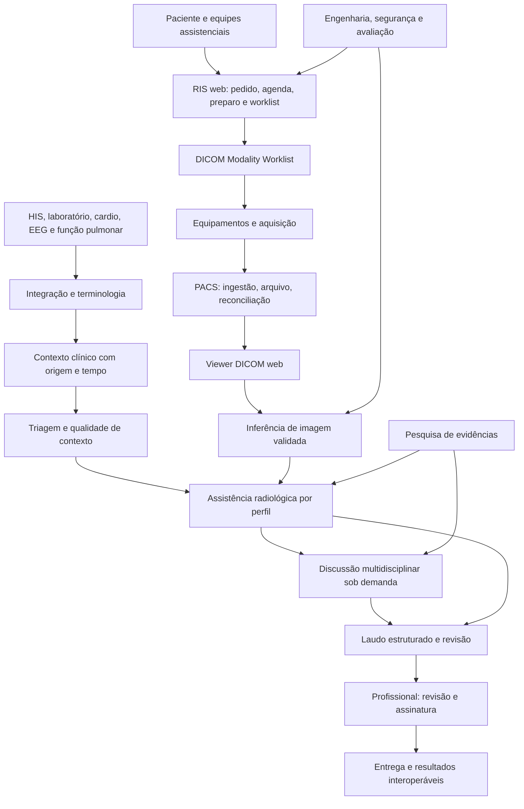

# Planner do projeto

## Objetivo

Criar uma plataforma PACS/RIS web integrada ao visualizador DICOM, com contexto clínico interoperável, laudos estruturados e agentes especializados. Evoluir para integração com funções HIS sem presumir que o primeiro MVP seja um prontuário hospitalar completo.

Construção compartilhada por **ChatGPT/Codex, Claude Code e Google Gemini**, conforme o [protocolo do conselho](CONSELHO-LLMS.md). As três ferramentas devem ler e atualizar a base no GitHub, discutir propostas e registrar decisões/evidências. A ambição de construir uma startup de grande escala orienta a descoberta de produto e a disciplina de execução; não constitui previsão de valuation.

## Mapa do produto

## Frentes e entregáveis

| Frente | Escopo planejado | Saída verificável |
|---|---|---|
| Viewer | CT, MR, MG, CR/DX, US; 2D, cine, medidas, MPR/3D conforme geometria | Imagem correta, medidas calibradas e persistência |
| PACS | DICOM/DICOMweb, armazenamento, retenção, recuperação e reconciliação | Conformance Statement, integridade, restore e auditoria |
| RIS | Cadastro, pedido, agenda, preparo, check-in, aquisição, worklist, laudo e entrega | Jornada rastreável com estados e autorização |
| Interoperabilidade | HL7 v2, FHIR, IHE, terminologias e integrações especializadas | Contratos por parceiro e testes com mensagens sintéticas |
| Laudos | Bases e módulos para US, TC, RM, MG e RX | Templates versionados, campos estruturados e revisão humana |
| IA clínica | Modelos por tarefa + perfis de análise e revisão | Achados ligados à evidência; escopo, incerteza e limitações |
| Pesquisa | Recuperação, leitura crítica e síntese de artigos | Evidência verificável com população, data e limitações |
| Engenharia autônoma | Descoberta técnica, propostas, sandbox e manutenção | Mudanças reproduzíveis, avaliadas e reversíveis |
| Segurança | Identidade, isolamento, privacidade, proteção e resposta | Controles testados, risco residual e exercícios de recuperação |

## Jornadas principais

**J1 — Exame e laudo:** pedido → identificação → agenda/preparo → chegada → worklist da modalidade → aquisição → reconciliação → qualidade → leitura → rascunho → revisão → assinatura → entrega → adendo, se necessário.

**J2 — Caso com IA:** contexto autorizado → checagem de completude → tarefa/modelo elegível → inferência → validação de geometria → análise por perfil → pesquisa e discussão quando indicadas → revisão independente → profissional responsável. Falta de dados, discordância e erro não podem virar “exame normal”.

**J3 — Atualização:** fonte oficial → candidato → revisão de licença e segurança → proposta → testes/avaliação → aprovação aplicável → implantação gradual → monitoramento → reversão. A pesquisa pode operar autonomamente; a promoção clínica não é decidida pela mesma IA que propôs a mudança.

## Marcos

| Marco | Entrega | Portão de saída |
|---|---|---|
| M0 — Planejamento | Este planner, squads e contratos | Consistência documental e decisões abertas identificadas |
| M1 — Fundação | Identidade, isolamento, armazenamento e observabilidade | Acesso, backup/restore e separação por organização testados |
| M2 — Jornada RIS/PACS | Pedido até abertura e reabertura do estudo | Identidade/pedido reconciliados, DICOMweb e MWL demonstrados |
| M3 — Laudos | Editor estruturado para as cinco modalidades | Template revisado, unidades, assinatura e adendo rastreáveis |
| M4 — Contexto interoperável | FHIR/HL7 e conectores especializados prioritários | Proveniência, temporalidade, terminologia e rejeição de mensagens inválidas |
| M5 — Assistência de IA | Uma tarefa de imagem e um fluxo de rascunho | Avaliação local e revisão clínica; sem extrapolação entre modalidades |
| M6 — Expansão | Subespecialidades, conselho assistivo e automação técnica | Qualidade por tarefa, custo, recuperação e governança demonstrados |
| M7 — Uso pretendido | Operação correspondente à finalidade aprovada | Avaliações regulatórias, organizacionais e técnicas aplicáveis concluídas |

Não há prazo ou custo fechado: volume, integrações, equipe, infraestrutura e finalidade clínica ainda precisam ser definidos. [Backlog detalhado](docs/06-roadmap.md).

## Organização dos agentes

Oito funções, com perfis reutilizáveis. Radiologia e conselho multidisciplinar podem abrir análises independentes em paralelo, mas somente quando o contexto for suficiente e o caso justificar. Isso preserva especialização sem acionar dezenas de agentes em todo exame.

1. Contexto e triagem.
2. Radiologia por subespecialidade.
3. Consultoria multidisciplinar.
4. Pesquisa e evidências.
5. Interoperabilidade em saúde.
6. Engenharia da plataforma.
7. Segurança e privacidade.
8. Qualidade clínica independente.

O workflow principal faz a coordenação; um “gerente LLM” não recebe autoridade ilimitada. Os agentes clínicos não são médicos licenciados e não substituem o signatário.
