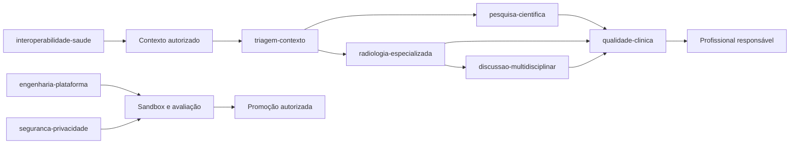

# Squad e contratos dos agentes

## Topologia

O catálogo contém oito funções e perfis de subespecialidade. Cada execução recebe objetivo, escopo, ferramentas, limite de custo/tempo e contrato de saída. A coordenação é código/workflow; não depende de um agente genérico com autoridade para delegar indefinidamente.

## Funções, entradas e saídas

| Agente | Entrada | Saída | Ferramentas futuras autorizáveis |
|---|---|---|---|
| triagem-contexto | Pedido, questionário, snapshot e protocolos aprovados | Lacunas, cronologia, contradições e sugestão de encaminhamento | Leitura de contexto e questionário; sem alteração silenciosa de prioridade |
| radiologia-especializada | Imagem/contexto elegíveis e resultados de modelo aprovado | Achados e rascunho com evidências, abstenção e limites | Viewer, medidas validadas e resultados de inferência; sem instalação de modelos |
| discussao-multidisciplinar | Pergunta e extrato mínimo pertinente | Parecer assistivo por especialidade e discordâncias | Consulta de contexto delimitado e corpus aprovado |
| pesquisa-cientifica | Pergunta desidentificada | Síntese crítica e proposta de atualização do corpus | Busca pública, bibliografia e revisão; sem acesso ao PACS |
| interoperabilidade-saude | Contratos/mensagens sintéticas e requisitos | Mapeamento, validação, proveniência e casos de erro | Validadores e sandbox de conectores; sem alterar identidade em produção |
| engenharia-plataforma | Requisito, testes e fontes oficiais | ADR, patch, avaliação e reversão | Repositório e sandbox; sem credencial clínica/admin universal |
| seguranca-privacidade | Arquitetura, artefatos e fluxo de dados | Threat model, achados e evidências de controles | Scanners autorizados e revisão; sem pentest externo por inferência |
| qualidade-clinica | Achados, texto, evidências e protocolos | Divergências, lacunas e condição de revisão | Leitura independente; não pode assinar nem aprovar a si própria |

## Subespecialidades

Perfis radiológicos: neurorradiologia, musculoesquelético, abdome/pelve, tórax, mama, cardiovascular, cabeça/pescoço, pediatria, oncologia, emergência e intervencionista. Perfis de discussão: cirurgia, ortopedia, neurologia, pneumologia, oncologia, otorrinolaringologia e vascular. Descrições e agentes responsáveis constam em `config/profiles.json`.

Um perfil descreve recorte, não capacidade diagnóstica comprovada. Roteamento por modalidade, anatomia, pergunta e população é explícito; modelo clínico, licença, dados e métricas são aprovados por tarefa. Casos pediátricos não herdam automaticamente validação adulta. Pareceres discordantes seguem para responsável humano, sem votação que esconda incerteza.

## Execução segura

1. Validar identidade e autorização, escopo e versão do contexto.
2. Determinar tarefas elegíveis e selecionar o mínimo de perfis.
3. Executar análises independentes com budgets e ferramentas estreitas.
4. Validar saída estruturada, origem, referências e limites; rejeitar formato inválido.
5. Reunir resultados sem apagar divergências; revisão independente.
6. Solicitar resolução profissional das pendências; assinatura fora da autoridade dos agentes.
7. Registrar versões, dados usados, decisões e resultados. Não registrar cadeia interna de raciocínio como prontuário.

Entradas e saídas seguem `schemas/case-context.schema.json` e `schemas/agent-result.schema.json`. A ausência de campo requerido interrompe a etapa dependente. Falta de evidência clínica gera abstenção, não preenchimento plausível.

## Autonomia e atualização

O catálogo mantém `runtime_enabled=false`; todos os agentes começam desativados. `config/autonomy-policy.json` define classes A0–A4. Pesquisa e experimentos podem ser automatizados em ambiente autorizado; promoção clínica/produção e assinatura permanecem em etapas distintas. A política precisa ser aplicada por serviços de autorização, não só lida por uma LLM.

Agente de engenharia acompanha releases, vulnerabilidades e ferramentas; pesquisador acompanha literatura. Ambos geram candidatos com licença, fonte, impacto, benchmark e reversão. Aprovação exige revisão adequada ao impacto, incluindo clínica quando pertinente. Nenhum agente troca o próprio modelo de produção por conta própria.

## Como usar os perfis agora

O orquestrador pode ler o perfil em `.Codex/agents/`, fornecer uma tarefa documental e gravar seu output em `runs/`. Os roteiros `.Codex/commands/pacs-planejar.md`, `pacs-revisar-caso-sintetico.md` e `pacs-atualizar.md` descrevem os fluxos. Eles não são comandos instalados automaticamente por este commit.

Convenção de ferramentas dos perfis: Read/Glob/Grep = leitura; Write/Edit = escrita delimitada; WebSearch/WebFetch = pesquisa; Bash = execução de comandos no ambiente permitido, inclusive PowerShell no Windows. Esse nome abstrato não concede um shell por si. O adaptador deve mapear para capacidades reais e negar ações sem binding/permissão. Skill referenciada só pode ser carregada se existir.

Para implantar agentes embarcados, implementar loader, registry de ferramentas, autorização por tarefa, persistência de estado, budgets, filas, validação dos contratos, avaliação e telemetria. Os arquivos deste planner são entradas desse trabalho, não agentes já conectados a exames reais.
